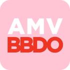
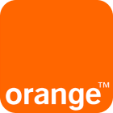
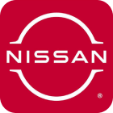
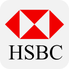

# I’m Ricky, a Senior Product Designer who loves solving complex problems.

I’m a Senior Product Designer based in London with over 15 years of experience across telecoms, energy, automotive, fintech, subscription services, ecommerce and smart TV. Moving between sectors allows me to bring a different lens to every brief. My last role was at British Gas, where I led the design for some of its most-used products and services. I integrate AI deeply into my workflow to accelerate research, prototyping, and synthesis, treating AI as a drafting engine while retaining rigorous oversight as quality controller.

## Core expertise

### Design methods

- All UX methodologies
- Behavioural Science principles
- Data analytics
- Design systems evolution
- Accessibility (WCAG)
- UI, prototyping and interactive design

### Leadership

- Leading end-to-end design on high-traffic journeys
- Setting product vision, design principles and direction
- Shifting teams from assumption-led shipping to evidence-based decisions
- Aligning multi-squad projects and senior stakeholders
- Mentoring and growing designers

### Team Collaboration

- Cross-functional agile squads with product managers, engineers, analysts and content designers
- Mapping Acceptance Criteria with stakeholders
- Working with global teams
- Contributing to a shared design system
- Collaboration with data insights teams

### Tool stack

- **Design and code:** Figma, Adobe Creative Suite, VS Code
- **AI:** Claude, Codex, Magic Patterns, Copilot, Figma Make
- **Research and analytics:** UserTesting, Content Square, Adobe Analytics
- **Collaboration:** Miro, Mural, FigJam
- **Project planning:** Axure DevOps, Jira, Confluence, Trello

### Soft Skills

- Confident presenter
- Pragmatic under tight deadlines and technical limits
- Curious about complex problems
- Challenges assumptions with evidence
- Builds lasting working relationships

### Hard Skills

- Native app design (iOS and Android)
- Responsive web design
- Android TV design
- Running remote and in-person workshops

## Achievements

- **British Gas, quote journey:** Cut a 16-step journey to 7, raised sales conversion from 6% to 8% (33% more customers acquired on the same traffic), and cut time to quote from 3m 26s to 1m 10s.
- **British Gas, app billing:** Cut paperless billing calls by 20% in three months, preventing 55,000 calls and saving £220,000.
- **EE, Cyber Security:** Reached an 11.2% sales conversion to paid antivirus plans among qualified ID Checker users, 3.5% above target. Users rated the purchase journey 6.6/7 and the breach check 6.8/7.
- **EE, Saved Cards:** Shipped an MVP in three weeks, lifted checkout conversion from 4.2% to 4.62% and cut inbound support calls by 20%.
- **Orange, Recycle:** Raised the collection of used phones from 15% to 28%.

## What colleagues say

### Ian Patrick

> Ricky was the perfect all round senior design professional on a project for James Wellbeloved, part of the Mars brand. From taking the design brief Ricky was able to build on it from day one and look after all the aspects liaising with producers, accounts teams, the client as well as the Creative Directors and myself. He was very efficient on the day to day tasks, always clear as to what he was doing and very ordered when the project was at its most demanding. Always communicative, easy to debate ideas with and finding solutions quickly with no fuss.
>
> Very adept at using inVision for reviewing and the project management tool Trello, Ricky is a great combination of practical and creative with a good eye for detail and an appreciation for keeping digital design clear and concise.
>
> A great person to have on your project.

**Design Director** · AMV BBDO

### Tatiana Kijak

> I worked with Ricky during 2 years on the Orange Branded Devices range - ‘Android smartphones distributed across Europe and specific emerging markets’. We were both part of a large team where our primary focus was to design and develop the software for all Orange Branded Devices. Ricky’s focus is always user centred design and chooses simplicity over complexity and keeps the design engaging, appealing and accessible. He understands perfectly the user’s needs and he brings the appropriate answer in collaboration with myself and the team. I strongly recommend Ricky if you have the chance to work with him, you will understand in a few days how precious he could be to a project.

**Product Owner** · Orange Telecoms

### Rebecca Comer

> Ricky joined our team as a freelance designer to work on a website for Mars, one of our most high-profile clients. He is an exceptional designer with a great eye for detail and an instinctive feel for usability and interaction.
>
> During the project, his interpretation of the wireframes was excellent. He created a beautiful, clean, fun user interface, and he worked quickly and efficiently to deliver everything on time. I am convinced that we could not have completed the work so quickly and to such a high standard without him.
>
> Everyone enjoyed working with Ricky. If we could keep him forever, we would!

**Senior Producer** · AMV BBDO

### George Bell

> Ricky is one of those hard working designers that takes great pride in everything he does no matter how big or small the project, he will still craft the living daylights out of a project to create award-winning design. He's a conceptual designer and will always bring something new to the team as he has great knowledge of everything design and is very much up to speed with what is going on. He never complains, has a great work ethic and is fast at what he does. He instantly knows what has to/can be done to push a piece of work. He's someone you can always trust to bring that 'wow factor' to whatever he designs.

**Creative Director** · TMW

### Joel Fernandes

> I worked with Ricky on a project for which? client which was a set of dynamic templates banners. Ricky involvement was designing / wireframing and he was always very consistent from start to finish. Ricky is also a very nice chap, it was a great working with him and hopefully will work together again.

**Senior Front-end Developer** · AMV BBDO

### Darren Jackson

> Ricky is a great creative designer, who pushes briefs to their limits, whilst considering tight deadlines and budgets. He is full of ideas and a good problem solver. Ricky is a confident communicator with colleagues and clients alike, he works well independently or as part of a team.

**Director of Procurement** · AMV BBDO

## Trusted by

       
